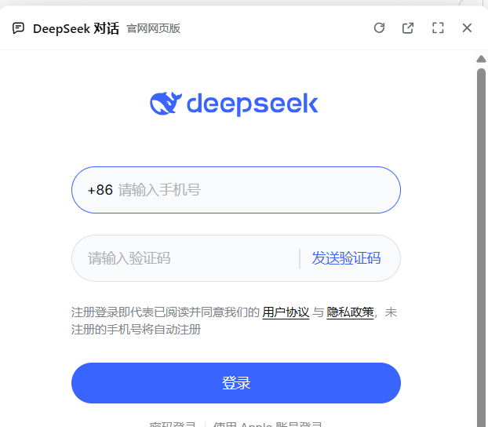

# DeepSeek 网页对话 · DSH 插件

[](LICENSE)

在 **DeepSeek Harness（DSH）** 桌面应用里打开一个浮动的 **官方 DeepSeek 网页版对话**窗口——加载的就是 `chat.deepseek.com` 本体，不是仿制界面。登录一次后本地记住，重启 DSH 不用反复登录。



> 仅支持 DSH **桌面应用**（Electron）。普通浏览器标签页无法嵌入该站点：`chat.deepseek.com` 返回 `Content-Security-Policy: frame-ancestors 'none'`。

## 功能

- 侧栏底部「DeepSeek 对话」入口，点击从右侧滑入浮窗
- 浮窗可拖动、右下角拉伸、贴右跟随（DSH 窗口尺寸变化时保持右边距）
- 最大化只铺满右侧内容区、保留 DSH 侧栏；带文字「还原」按钮，双击标题栏也可还原
- 右侧滑入 / 滑出动画，遵循系统「减少动态效果」
- 登录一次自动记住（本机会话快照），重启 DSH 仍保持登录
- 关闭只是隐藏页面，再打开秒回，页面内对话状态保留
- 中文 / English 文案，跟随 DSH 语言
- 纯前端插件：无 Host 进程、无本地代理、不接管网络

## 环境要求

- DSH 桌面应用（Electron）。开发与测试版本：`0.2.2-rc.1`
- Windows 10/11（主要测试平台）；macOS 理论可用，未充分测试
- 不需要 DeepSeek API Key，不需要配置代理

## 安装

### 从 GitHub 安装（推荐）

1. 打开 DSH → 设置 → 插件
2. 点「添加插件」，填入仓库地址：

   ```text
   https://github.com/wenshiyu123/dsh-deepseek-web-chat
   ```

3. 安装完成后，侧栏底部（账户行上方）会出现「DeepSeek 对话」

### 从本地目录安装

```bash
git clone https://github.com/wenshiyu123/dsh-deepseek-web-chat.git
```

然后在 DSH 插件页添加这个本地目录，或让 Agent 使用 `plugin_manager` 安装该目录。

> 如果安装后界面没有出现入口，**完全退出 DSH 再启动**。关闭窗口只是隐藏到托盘，不会重新加载页面。

## 使用

1. 点侧栏底部「DeepSeek 对话」
2. 第一次在浮窗里用手机号 / 微信 / 邮箱登录（和官网完全一致）
3. 登录后停留十几秒，标题栏会出现「登录已记住」
4. 之后每次打开、甚至重启 DSH，都会自动恢复登录态

退出登录：在浮窗里点官网右上角头像 → 退出登录；本地快照会自动清除。

## 实现原理

- 这是一个纯 Client 插件：`client.js` 注册 `sidebar.footer.action`（入口）和 `shell.overlay`（浮窗）
- 通过 DSH 桌面端预加载脚本提供的 webview 租约（`window.dshDesktop.browser.acquire`）创建隔离的 `<webview>`，先附着到 `about:blank#<lease>`，再导航到 `https://chat.deepseek.com/`
- 页面运行在 sandbox、无 Node、无 preload、上下文隔离的 guest 中，读不到 DSH 的 DOM、存储或接口
- 登录快照：官网把登录态保存在自己的 `localStorage.userToken`（Bearer token）。插件在登录后把该站点的 localStorage 快照写入 DSH 本机应用数据；下次打开时先在同源空页面注入，再进入官网，因此直接是登录态
- 没有服务端、没有反向代理，不修改 DSH 安装包

## 隐私与安全

- 只连接 `chat.deepseek.com`，不发送任何遥测
- 登录快照保存在本机 DSH 应用数据中（与浏览器 Cookie 同级），仅当前系统用户可读；能运行你账号下程序的进程理论上也能读
- 快照包含官网登录 token、用户信息和设备标识；退出登录会清除，移除插件后也可手动清理 DSH 应用数据
- 不读取、不保存你的 DeepSeek API Key
- 本项目与 DeepSeek 官方无隶属关系

## 已知限制

- 仅 DSH 桌面应用；浏览器标签页不可用（站点禁止 iframe 嵌入）
- 桌面端对嵌入页面默认拒绝权限：复制到剪贴板、`alert/confirm`、麦克风/通知可能不可用；弹窗会交给系统浏览器打开
- 官网改版、token 过期或风控要求二次验证时，会自动回到登录页，需要重新登录一次
- 最大化按 Windows 的窗口变量计算安全区；macOS 未充分验证，可能退化为整窗铺满
- 不做任何账号绑定：DSH 账号与官网账号是两套登录，插件只负责记住官网自己的登录态

## 目录结构

```text
.
├── client.js            # 全部界面、动效与 webview 生命周期
├── index.js             # Host 空壳（bundle 需要一个 Host 入口）
├── cordis.patch.yml     # bundle 插入的插件行
├── locale/
│   ├── en.json          # 插件管理页的英文标题/描述
│   └── zh.json          # 插件管理页的中文标题/描述
├── icon.svg             # 插件图标
└── docs/preview.png     # README 预览图
```

## 开发

```bash
node --check client.js
```

改动后重新安装本目录到 DSH 插件即可；Client 代码更新通常需要重启 DSH 才会加载。

欢迎 Issue / PR，见 [CONTRIBUTING.md](CONTRIBUTING.md)。

## English

A floating window that hosts the **official** DeepSeek web chat (`chat.deepseek.com`) inside DeepSeek Harness (DSH) desktop. Drag, resize, maximize, slide-in animation, and one-time sign-in remembered locally. The embedded page runs in an isolated, sandboxed webview without Node or preload access.

Desktop only — the site forbids iframe embedding (`frame-ancestors 'none'`).

Install: DSH → Settings → Plugins → Add plugin → `https://github.com/wenshiyu123/dsh-deepseek-web-chat`.

## License

[MIT](LICENSE)
